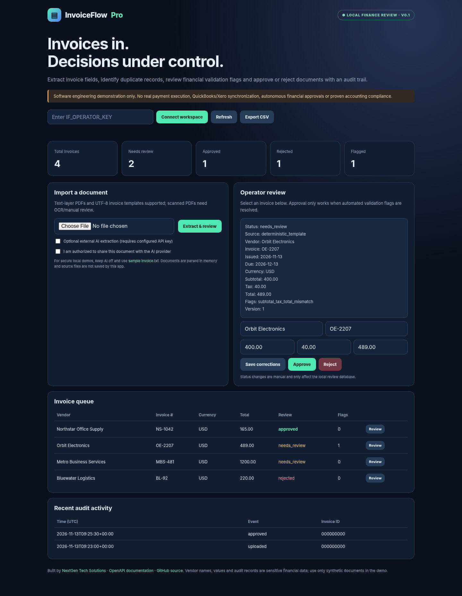
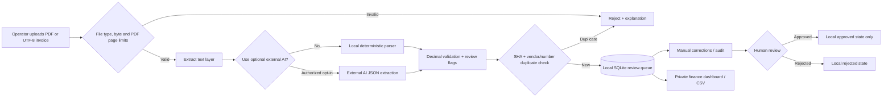

<div align="center">

# InvoiceFlow Pro
### Invoices in. Validations first. Human approvals under control.

**An accounts-payable engineering showcase: PDF/text intake, structured extraction, duplicate detection, arithmetic checks, reviewer corrections, audit history and a finance dashboard.**

[](#quick-start)
[](#architecture)
[](https://github.com/rajachanna/InvoiceFlow-Pro/actions/workflows/tests.yml)
[](#what-is-actually-implemented)
[](LICENSE)

**[Dashboard](src/invoiceflow/static/index.html) · [Invoice parser](src/invoiceflow/extract.py) · [Workflow engine](src/invoiceflow/store.py) · [Run the demo](scripts/demo.py) · [Case study](docs/CASE_STUDY.md) · [Client brief](docs/CLIENT_BRIEF.md)**

</div>

---



<sub>Illustrative interface preview using synthetic, mocked API records; not a deployed service.</sub>

## Business use case

Accounts-payable workflows face recurring problems: vendor invoices arrive in different formats, duplicate uploads slip through, amounts do not match, and review decisions are difficult to trace. InvoiceFlow Pro models the core workflow behind a safer invoice intake and review product.

**This is a locally run prototype, not a production accounting platform.** No real bank transfers, automatic payouts, QuickBooks or Xero synchronization, or accounting-provider permissions are implemented. All uploads require an operator key; the source document is processed in memory, while structured extracted fields are persisted locally.

## What is actually implemented

| Engineering feature | Implementation | Important boundary |
| --- | --- | --- |
| PDF upload | `pypdf` text-layer extraction, page/file-size limits | Scanned/image-only PDFs require OCR; **not supported** |
| Text invoices | UTF-8 invoice template parser | Deterministic labels: not a general-purpose parser for arbitrary layouts |
| Optional AI extraction | Operator opt-in + authorization checkbox; optional OpenAI JSON mode adapter | Off by default; **not provider-tested**, and outputs always need human verification |
| Field validation | Invoice ID, vendor, date, ISO currency format, nonnegative values | Cannot verify vendor legitimacy or detect fraud |
| Financial arithmetic | Subtotal + tax = total; line item arithmetic with Decimal | Tax law/FX/tax-code compliance **not validated** |
| Duplicate detection | SHA-256 source digest plus normalized vendor + invoice-number key | Cannot detect every forged or semantically altered invoice |
| Human review | `needs_review` → `approved` or `rejected`, correction workflow, optimistic versions | Approval is a local record status, **not a payment instruction** |
| Audit events | Upload, correction and operator decision timestamps in SQLite | Not immutable or externally notarized |
| Dashboard | Metrics, file upload, document correction, review buttons, audit log, CSV export | Local single-operator demo only |
| Automated verification | Offline tests, generated text-based PDF round-trip, demo CLI | CI does not prove external accounting integrations |

## Architecture



**Financial data does not automatically leave your machine.** Optional AI mode requires explicit per-upload authorization and an independently configured API key. Read [SECURITY.md](SECURITY.md) before using real vendor/customer data.

## Quick start

### Python 3.11+

```bash
git clone https://github.com/rajachanna/InvoiceFlow-Pro.git
cd InvoiceFlow-Pro
python -m venv .venv
# macOS/Linux: source .venv/bin/activate
# Windows: .venv\Scripts\activate
python -m pip install -e '.[dev]'
cp .env.example .env
```

Edit `.env` and replace `IF_OPERATOR_KEY` with a **fresh strong random secret (32+ characters)**. The Python server reads *environment variables*, not `.env` automatically:

```bash
# macOS/Linux:
set -a; source .env; set +a
uvicorn invoiceflow.api:app --host 127.0.0.1 --port 8000
```

For Windows PowerShell, set the required `IF_OPERATOR_KEY` and optional other settings as environment variables before running Uvicorn.

**Dashboard:** http://127.0.0.1:8000/  
**Interactive API:** http://127.0.0.1:8000/docs  
**Health:** http://127.0.0.1:8000/health

### Docker

```bash
cp .env.example .env
# edit .env with a strong operator key
docker compose up --build
```

The container service binds to **localhost only** by default. Its SQLite database is stored in a named volume; no public web deployment is configured.

## A test invoice without private data

The repository contains [a fictional sample](examples/invoice-sample.txt) with these fields:

```text
Vendor: Northstar Office Supply
Invoice Number: NS-1042
Invoice Date: 2026-11-03
Due Date: 2026-12-03
Currency: USD
ITEM: Laptop stand | 2 | 45.00 | 90.00
ITEM: Desk mat | 3 | 20.00 | 60.00
Subtotal: 150.00
Tax: 15.00
Total: 165.00
```

Run a repeatable offline walkthrough:

```bash
python scripts/demo.py
```

It uploads the sample, confirms initial review flags are empty, attempts a duplicate upload (HTTP 409), makes a human-simulated approval, and prints local metrics. **No accounting system, AI model or bank service is contacted.**

### Operator API

All endpoints under `/api/*` require `X-Operator-Key: YOUR_IF_OPERATOR_KEY`.

```bash
# Upload invoice document
curl -X POST http://127.0.0.1:8000/api/invoices/upload \
  -H 'X-Operator-Key: YOUR_IF_OPERATOR_KEY' \
  -F 'file=@examples/invoice-sample.txt'

# Inspect queue and metrics
curl -H 'X-Operator-Key: YOUR_IF_OPERATOR_KEY' \
  http://127.0.0.1:8000/api/invoices
curl -H 'X-Operator-Key: YOUR_IF_OPERATOR_KEY' \
  http://127.0.0.1:8000/api/metrics
```

For invoice correction, use `PATCH /api/invoices/{id}` with `version` and `fields`. The reviewer calls `POST /api/invoices/{id}/review` with `version`, `action` (`approve` or `reject`) and optional `note`. The server rejects approval if unresolved validation flags exist, and prevents reviewers from overwriting changes made by another operator without refreshing.

## Optional AI extraction (explicit, never automatic)

Install optional dependencies and configure an API key locally:

```bash
pip install -e '.[ai]'
# Set IF_OPENAI_API_KEY in local environment; never commit or publish it.
```

For a **document you have legal permission to send to the third-party AI provider**, submit a form with `use_ai=true` **and** `ai_authorized=true`. The AI adapter uses JSON object output, whitelists invoice fields and then passes results through local validation. **An AI estimate or hallucinated field may pass arithmetic checks: human source verification is mandatory.** This adapter has been tested with mocks only, not a connected external AI account.

## Tests and evidence

```bash
python -m pytest -q
```

The tests cover schema/quantity validation, PDF text extraction, missing/mismatched totals, vendor/number duplicate detection, concurrent-review version conflicts, file upload limits, operator authentication, manual approval lifecycle, CSV export and AI adapter failure scenarios.

**GitHub Actions:** [Test workflow and latest run](https://github.com/rajachanna/InvoiceFlow-Pro/actions/workflows/tests.yml). Only call CI successful after an actual recorded passing run.

## What is planned rather than delivered

- OCR for image-only/scanned PDF invoices
- Layout-sensitive AI extraction with field-by-field evidence and confidence checks
- Supplier identity/matching and purchase-order reconciliation
- Human multi-user roles, immutable audit and fraud detection
- Bidirectional **QuickBooks/Xero** sandbox integrations, provider-authenticated demos and reconciliation
- Full invoice lifecycle notifications, cost center coding and export to ERP
- Privacy/compliance hardening and production operations

See [ROADMAP.md](ROADMAP.md) for proposed next milestones. No actual payment execution will be introduced without a separately reviewed and explicitly authorized workflow.

## Developer / professional inquiry

**Raja Channa — NextGen Tech Solutions**  
Python automation · document processing · workflow integrations · finance operations software · dashboards & API systems

**[Company website](https://nextgentechdev.com)** · **[GitHub](https://github.com/rajachanna)** · **[Client project brief](docs/CLIENT_BRIEF.md)**

<sub>MIT licensed. Engineering prototype only — not accounting, legal, tax or financial advice; no claims of production readiness, vendor verification or guaranteed business outcomes.</sub>
